# Full CI/CD GitOps Project

## Overview

This project brings together the DevOps tools and practices covered throughout the iVolve training labs.

It uses a Node.js application connected to MySQL to demonstrate containerization, Kubernetes orchestration, CI/CD automation, GitOps, and infrastructure monitoring.

The repository combines configurations from the completed labs into one project structure. Screenshots from the original labs are included as evidence of the individual workflows.

## Tools and Technologies

- **Node.js & MySQL:** Application and database
- **Docker & Docker Compose:** Containerization and local multi-container setup
- **Kubernetes:** Application orchestration and persistent storage
- **Jenkins:** CI/CD automation
- **Jenkins Shared Library:** Reusable pipeline functions
- **Trivy:** Container image vulnerability scanning
- **Docker Hub:** Container image registry
- **Argo CD:** GitOps-based continuous delivery
- **Prometheus & Grafana:** Monitoring and visualization
- **Git & GitHub:** Version control and GitOps repository

## Architecture

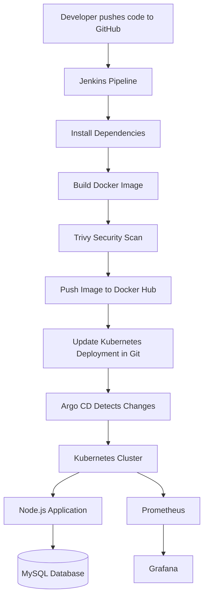

## Project Structure

```text
Full-CICD-GitOps-Project/
├── app/
│   ├── Dockerfile
│   ├── docker-compose.yml
│   ├── package.json
│   ├── package-lock.json
│   ├── server.js
│   ├── db.js
│   └── frontend/
├── kubernetes/
│   ├── namespace.yaml
│   ├── deployment.yaml
│   ├── mysql-statefulset.yaml
│   ├── services.yaml
│   ├── configmap.yaml
│   └── storage.yaml
├── jenkins/
│   ├── agent/
│   │   └── Dockerfile
│   └── shared-library/
│       └── vars/
├── argocd/
│   └── application.yaml
├── examples/
│   └── secret.example.yaml
├── screenshots/
│   ├── docker/
│   ├── kubernetes/
│   ├── jenkins/
│   ├── argocd/
│   └── monitoring/
├── Jenkinsfile
├── .gitignore
└── README.md
```

## 1. Docker and Docker Compose

The Node.js application is packaged into a Docker image.

Docker Compose defines the application and MySQL services, including networking and persistent volumes.

The application communicates with MySQL using environment variables.

### Docker Lab Evidence

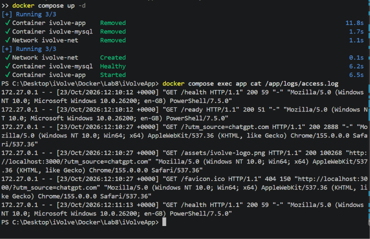

## 2. Kubernetes Deployment

Kubernetes manifests define the resources needed to run the application.

The configuration includes:

- A separate namespace for the project
- A Deployment for the Node.js application
- A StatefulSet for MySQL
- ClusterIP and headless Services
- ConfigMap for non-sensitive configuration
- Secret template for documenting required credentials
- PersistentVolumes and PersistentVolumeClaims for storage
- Resource requests, limits, readiness probes, and scheduling constraints

### Kubernetes Lab Evidence

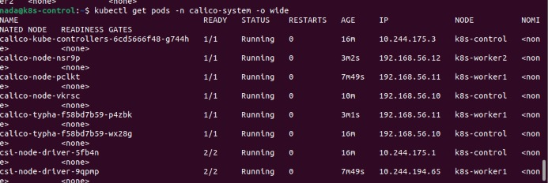

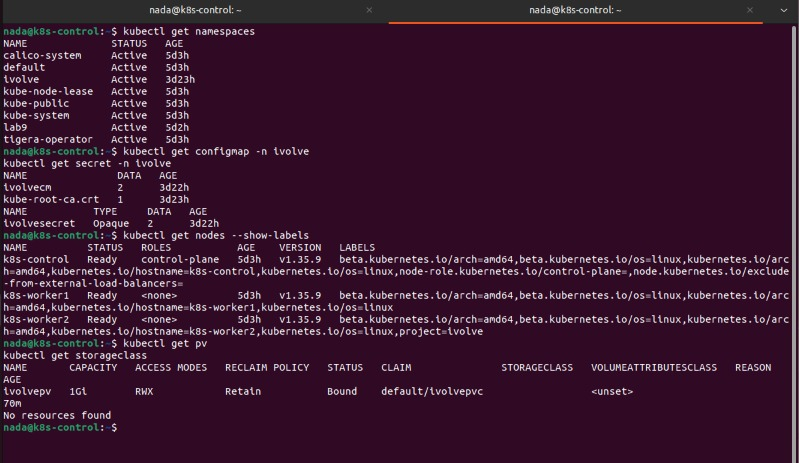

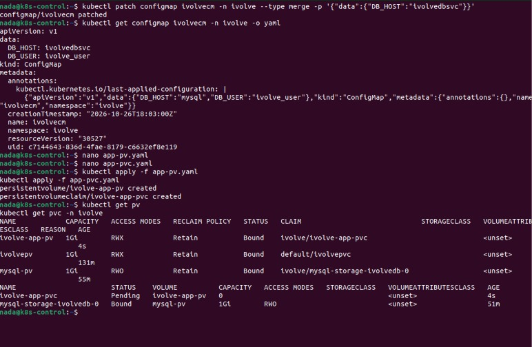

## 3. Jenkins CI/CD Pipeline

The Jenkinsfile defines the following CI stages:

1. Checkout source code from GitHub
2. Install Node.js dependencies and run available tests
3. Build the Docker image
4. Scan the image using Trivy
5. Push the image to Docker Hub
6. Update the image tag in the Kubernetes Deployment manifest
7. Commit and push the updated manifest to GitHub

Reusable functions are organized in a Jenkins Shared Library.

### Jenkins Lab Evidence

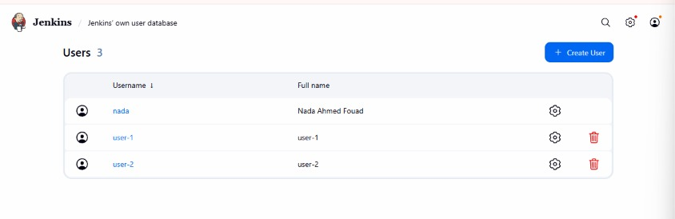

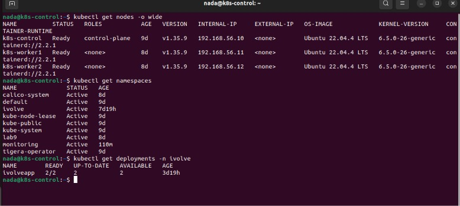


## 4. GitOps with Argo CD

Argo CD monitors the Kubernetes manifests stored in GitHub.

When Jenkins updates the application image tag and pushes the change, Argo CD can detect the updated manifest and synchronize the application with the Kubernetes cluster.

The Argo CD Application definition is included in `argocd/application.yaml`.

### Argo CD Lab Evidence

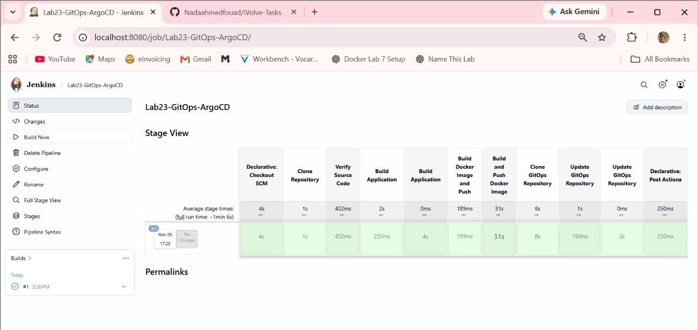

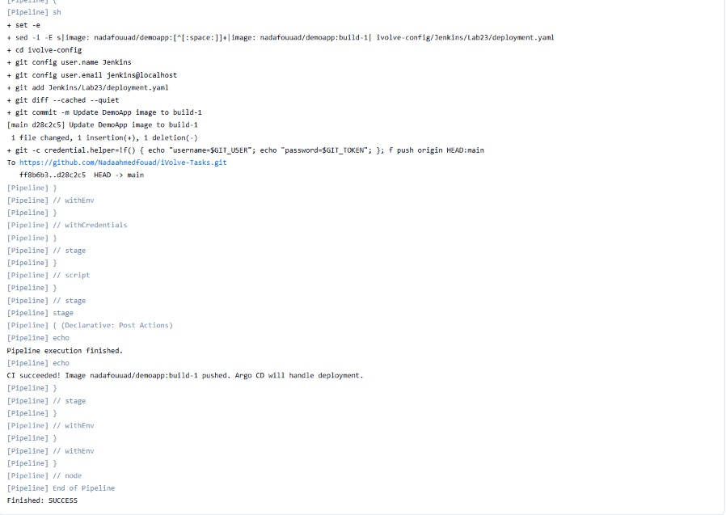

## 5. Monitoring

Monitoring was implemented during the Kubernetes labs using Prometheus, Node Exporter, and Grafana.

Prometheus collects metrics, while Grafana provides dashboards for visualization.

### Monitoring Lab Evidence

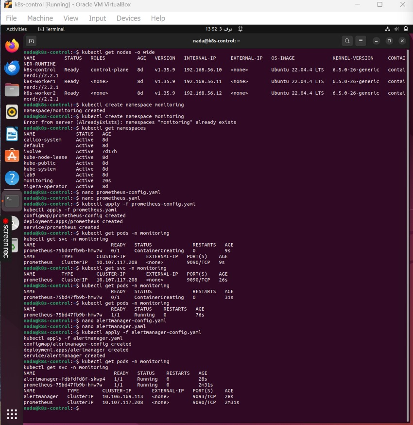

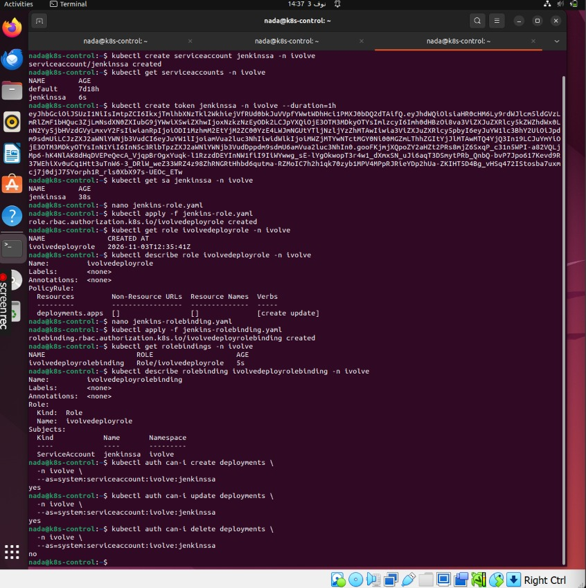

## 6. Security and Configuration

Sensitive values should not be committed to GitHub.

The project includes `.env.example` and `examples/secret.example.yaml` to document required configuration without exposing actual credentials.

Jenkins uses credentials stored in its credential manager for Docker Hub and GitHub authentication.

Trivy is included in the CI pipeline to scan container images for known vulnerabilities.

## Project Status

This repository consolidates the application, Kubernetes manifests, Jenkins pipeline definitions, shared-library functions, Argo CD configuration, and screenshots from previously completed labs.

The original lab workflows were implemented and tested independently. The new combined project configuration has been prepared, but an end-to-end deployment of this specific repository has not yet been verified.
